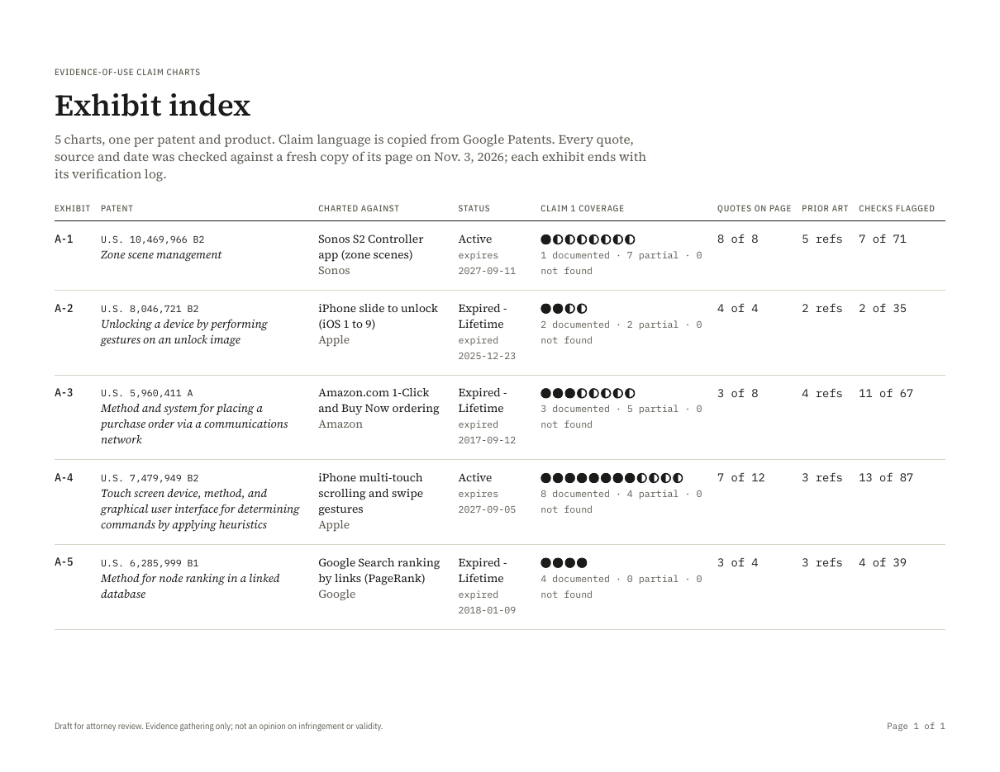
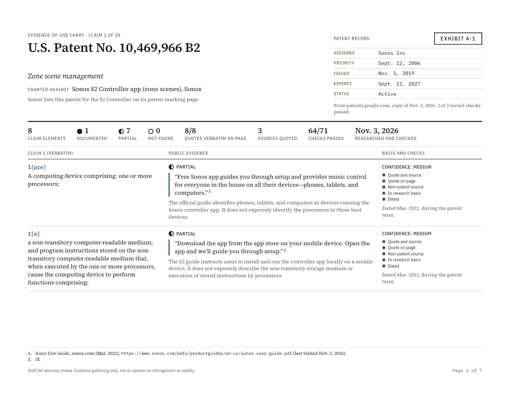
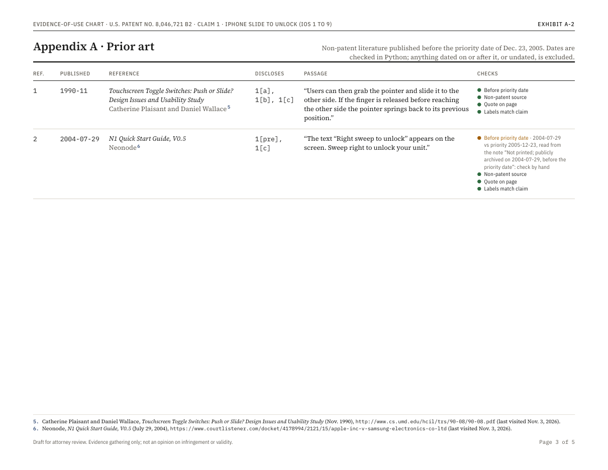
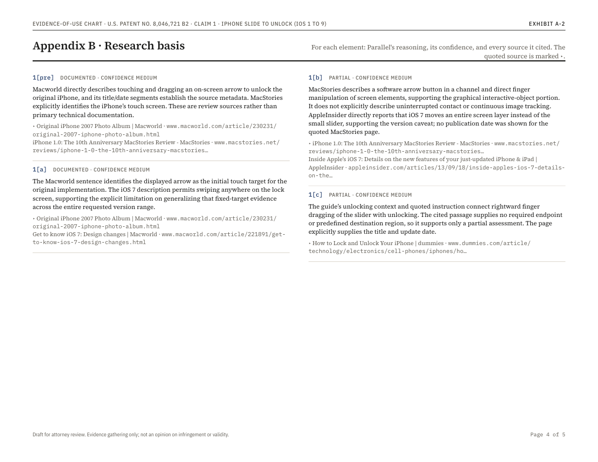
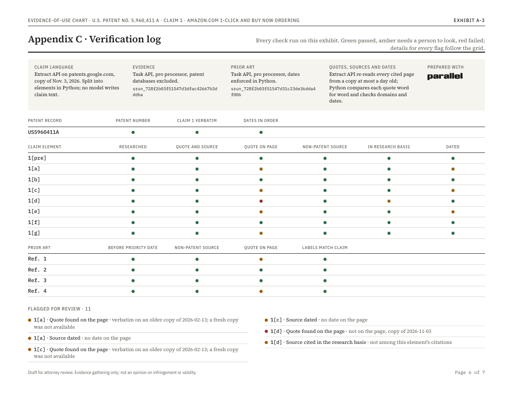

# Parallel Claim Charts

Turn a CSV of patents and products into evidence-of-use claim charts. Claim 1 is copied verbatim from Google Patents, the [Parallel Task API](https://docs.parallel.ai/task-api/task-quickstart) finds public evidence for every element, and every quote, source, date and prior-art reference is checked in Python against a fresh copy of the page it came from. Each chart is a landscape PDF exhibit with footnoted citations, Parallel's confidence and reasoning for every finding, and a log of every check.

| Exhibit index | Claim chart, page 1 | Prior art |
| --- | --- | --- |
| [](sample/claim-charts.pdf) | [](sample/pdf/US10469966B2--sonos-s2-controller-app-zone-scenes.pdf) | [](sample/pdf/US8046721B2--iphone-slide-to-unlock-ios-1-to-9.pdf) |

| Research basis | Verification log |
| --- | --- |
| [](sample/pdf/US8046721B2--iphone-slide-to-unlock-ios-1-to-9.pdf) | [](sample/pdf/US5960411A--amazon-com-1-click-and-buy-now-ordering.pdf) |

## Sample input and output

- **Input:** [`patents.csv`](patents.csv), five patents, each charted against a product its owner makes or marks: Sonos's zone-scene patent against the S2 Controller app (still active), Apple's slide-to-unlock and multi-touch patents against the iPhone, Amazon's 1-Click patent against Amazon.com, and the PageRank patent against Google Search.
- **Output:** one chart per row in [`sample/pdf/`](sample/pdf), the combined book with an exhibit index ([`sample/claim-charts.pdf`](sample/claim-charts.pdf)) and a one-row-per-chart summary ([`sample/portfolio.csv`](sample/portfolio.csv)).
- **Raw results:** [`sample/data/`](sample/data), the research, basis and every check behind each chart.

## What it shows

- **Claim language is copied, never generated.** [Extract](https://docs.parallel.ai/extract/extract-quickstart) reads the Google Patents page and a parser splits claim 1 into elements labelled `1[pre]`, `1[a]`, `1[b]`, the way claim charts cite them. A check confirms every element appears word for word on the page.
- **One research run per chart.** A single `pro` Task run covers every element of the claim, with patent databases excluded so the patent can't become its own evidence. A second `pro` run per patent looks for non-patent prior art.
- **Every data point is verified.** Extract re-reads every cited page, using a copy no more than a day old, and Python checks each quote word for word, each source's domain and date, and each prior-art date against the priority date. Nothing is silently dropped: failures are marked on the chart and listed in its verification log.
- **The basis is on the page.** Each row shows Parallel's confidence and the result of each check. Appendix B gives Parallel's reasoning and every source it cited for each element.
- **Freshness is explicit.** Every citation carries the page's own date and a "last visited" date: the date of the copy the quote was checked against. The patent record shows when its status was read, and each source is placed before, during or after the patent term.

## Quick start

```bash
cd python-recipes/parallel-claim-charts
cp .env.example .env            # add your PARALLEL_API_KEY
uv run claimchart.py patents.csv --limit 2
```

`--limit 2` charts the first two rows (four Task runs, about $0.40) so you can check the output before running the whole file. PDFs land in `out/pdf/`, the book in `out/claim-charts.pdf` and the summary in `out/portfolio.csv`. `--render-only` rebuilds the PDFs from saved results without calling the API, which is the fast loop for changing the design.

PDF rendering uses [WeasyPrint](https://weasyprint.org), which needs the Pango library: `brew install pango` on macOS (the script finds Homebrew's copy on its own), `sudo apt install libpango-1.0-0 libpangoft2-1.0-0` on Debian or Ubuntu. Fonts (Source Serif 4, IBM Plex Sans Condensed, IBM Plex Mono) load from Google Fonts at render time.

Without uv: `pip install parallel-web jinja2 weasyprint python-dotenv`, then `python claimchart.py patents.csv`.

## Your own patents

The CSV needs `patent_number` and `product`. `company` helps the research tell similar products apart, and `note` is printed on the chart as context, for example why the pairing was chosen.

```csv
patent_number,product,company,note
US10469966B2,Sonos S2 Controller app (zone scenes),Sonos,Sonos lists this patent for the S2 Controller on its patent marking page.
```

Use the full publication number with its kind code (`US10469966B2`, `US5960411A`), as Google Patents shows it. The same patent can appear on several rows with different products; its prior-art search runs once.

## How it works

```
patents.csv
   │
   ├─ Extract   patents.google.com → claim 1 split into elements, priority, grant, expiry, status   (no model)
   │
   ├─ Task Group ─┬─ evidence   pro   every element of claim 1, one run per row          (patent databases excluded)
   │              └─ prior art  pro   non-patent literature, one run per patent          (before the priority date)
   │
   ├─ Extract   every cited page, fresh (≤ 1 day old) → quote, domain and date checks in Python
   │
   └─ render    chart.html.j2 → one PDF per row, a book with an exhibit index, portfolio.csv
```

Everything is in [`claimchart.py`](claimchart.py): the research specs, the parser, the checks and the renderer. [`chart.html.j2`](chart.html.j2) is the page design.

### The checks

| Data | Check | Fails when |
| --- | --- | --- |
| Patent record | Patent number matches the page | Google Patents returned a different patent |
| | Claim 1 copied verbatim | An element is missing from the page, or claim 1 has fewer than two elements |
| | Dates parsed and in order | Priority, grant and expiry dates are missing or out of order |
| Each claim element | Element researched | The research skipped the element |
| | Quote and source given | A documented or partial finding has no quote, or a not-found one does |
| | Quote found on the page | The quote is not on a fresh copy of the page (a partial match or an unreadable page is flagged) |
| | Not a patent document | The source is a patent database |
| | Source cited in the research basis | The quoted page is not among Parallel's citations for that element (flagged) |
| | Source dated | The date is invalid or in the future (a missing date is flagged) |
| Each prior-art reference | Published before the priority date | Dated on or after it (the same month or year is flagged), or undated |
| | Not a patent document | It is a patent or patent application |
| | Quote found on the page | Flagged only: paywalled papers often hide their full text |
| | Element labels match the claim | Flagged when it cites elements claim 1 doesn't have |

A patent that fails a record check is skipped before any Task run is paid for. A prior-art reference that fails a check moves to an "excluded" list on its page, with the reason.

### Design decisions

**One run per claim, on `pro`.** On four patents, one `pro` run per claim found evidence for 27 of 27 elements, with 24 quotes verbatim on the page. That was as complete as one `pro` run per element, at about a sixth of the cost. `ultra` cost three times as much and did no better. One `core` run per element was cheaper still, but it reused a single help-page sentence for five of six elements on the 1-Click patent.

**Copy legal text; check everything else.** No model writes claim language. Everything a model returns (quotes, sources, dates, prior art) is checked against the page it came from, and the result is printed next to it.

**Dates are enforced in code.** Prior art has to predate the priority date, and the Task API has no "published before" filter. The prompt states the cutoff, and Python rejects anything dated on or after it, flagging same-period dates for a person.

**Freshness has a date, not a promise.** Quote checks ask Extract for a copy no more than a day old (`fetch_policy.max_age_seconds`). The date of the copy actually used is printed as the "last visited" date in Bluebook style, so an old copy shows up as an old date.

**Resumable by construction.** The Task Group id is written to `out/runs.json` before anything is submitted, and every run carries its row in metadata. Running the same command again finds the existing runs, submits only what is missing, and re-checks every quote against fresh copies of the pages. Submission retries are disabled so a network error can't create duplicate runs.

## Cost and time

Per chart: one `pro` evidence run, plus one `pro` prior-art run per patent, about **$0.20** at [list prices](https://docs.parallel.ai/getting-started/pricing), plus a fraction of a cent for Extract. Runs execute concurrently, so wall-clock time is set by the slowest run rather than the number of rows.

On the bundled five patents (November 2026): 10 Task runs, no failures, 7.9 minutes end to end, about $1.04 including Extract. The charts cover 36 claim elements (18 documented, 18 partial). Of 36 quotes, 25 matched a fresh copy of their page word for word; 5 matched only an older cached copy because the live page could not be fetched, 3 matched partly, 1 page could not be read at all, and 2 were not on the page. The last six are flagged on their charts rather than hidden. All 17 prior-art references predate their priority dates; one, a 2004 product guide whose date was given as a note, is flagged for a person to confirm.

## Limitations

- Evidence comes from public pages. Source code, internal documents and teardowns behind paywalls are out of reach, and server-side claim elements are often only partly documented in public. The chart marks those as partial and says what is missing.
- Claim 1 only. Dependent claims and other independent claims are not charted.
- The parser reads Google Patents' current page layouts; if a layout changes, the record checks fail and the patent is skipped rather than charted wrongly.
- A quote that matches the page shows the page says it, not that the product does it. These charts are a starting point for counsel, not an opinion on infringement or validity.

## License

MIT
