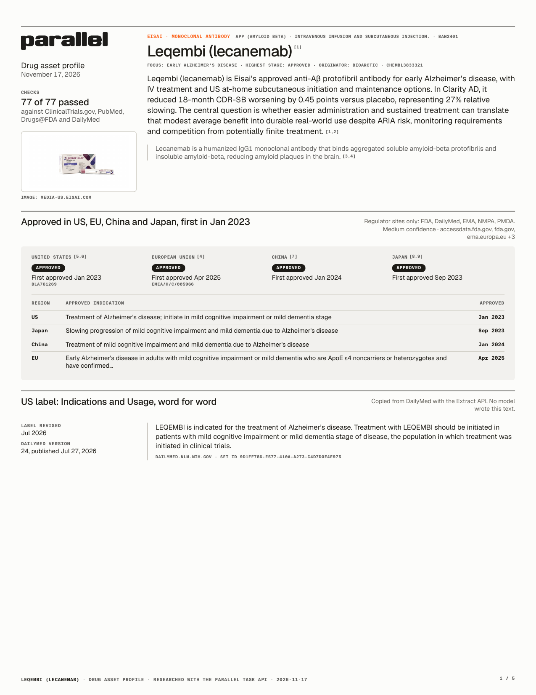
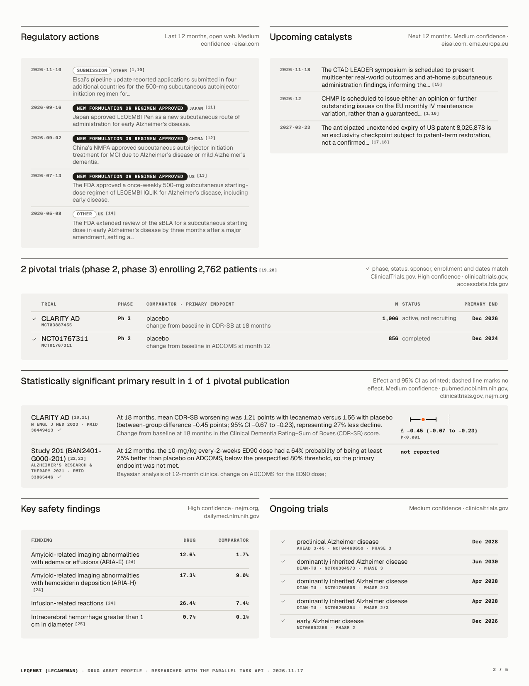
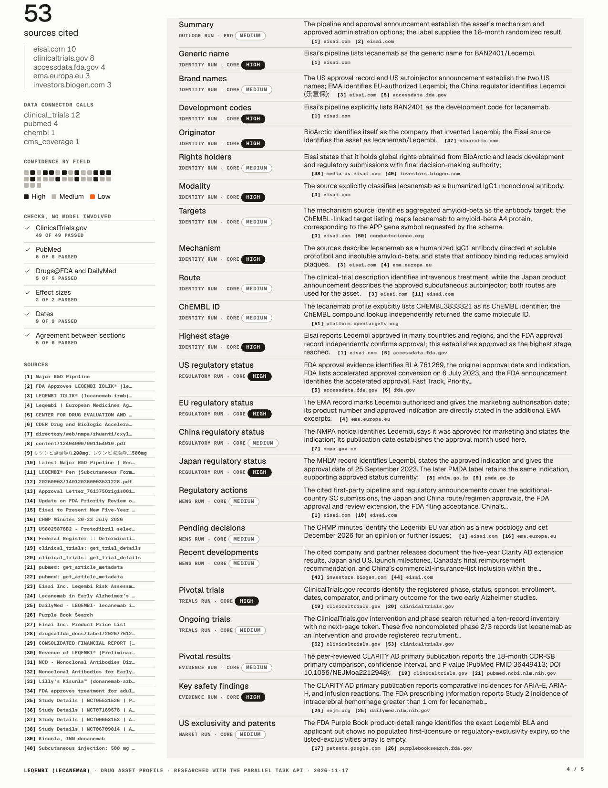

# Parallel Drug Asset Profiles

Turn a CSV of drugs into cited asset profiles, one PDF per drug plus a combined book. Each profile covers regulatory status in the US, EU, China and Japan; the US label's "Indications and Usage" section, copied word for word; pivotal trials and their published results; ongoing trials; US exclusivity and Medicare coverage; an outlook; and an official product photo. Every fact comes from the [Parallel Task API](https://docs.parallel.ai/task-api/task-quickstart) with its citations, reasoning and confidence. Every trial ID, PubMed ID, FDA application and label is then checked against its public registry by plain Python. No other model is involved.

| Profile, page 1 | Profile, page 2 | Research basis |
| --- | --- | --- |
| [](sample/leqembi.pdf) | [](sample/leqembi.pdf) | [](sample/leqembi.pdf) |

## Sample input and output

- **Input:** [`assets.csv`](assets.csv), three rows of `asset, sponsor, focus_indication`. The asset can be a brand name, a generic name or a development code.
- **Output:**
  - [`sample/leqembi.pdf`](sample/leqembi.pdf): a biologic approved in all four regions, with an accelerated approval, a boxed warning and Medicare coverage tied to a registry.
  - [`sample/remibrutinib.pdf`](sample/remibrutinib.pdf): a small molecule approved in 2025, whose US label added a second indication in October 2026.
  - [`sample/ivonescimab.pdf`](sample/ivonescimab.pdf): approved only in China, with Chinese-language sources, and a US application that received a complete response letter.
- **Raw research:** [`sample/leqembi.json`](sample/leqembi.json), the seven Task API results behind the Leqembi profile, with each field's citations, reasoning and confidence, plus the copied label and every check result. Page excerpts are removed from the sample.

The PDFs and previews show the original November 17 run and predate the corrections to label extraction, unknown approval statuses and biologic exclusivity. Run the current recipe for updated profiles.

## What it shows

- **Free healthcare Data Connectors.** Sections call [ChEMBL, ClinicalTrials.gov, PubMed and CMS Coverage](https://docs.parallel.ai/resources/data-connectors) alongside the open web, selected per run with `advanced_settings.data_sources`. The processor decides when to call them and cites what it used.
- **A source policy per section.** The regulatory run reads only regulator sites (FDA, DailyMed, EMA, NMPA, CDE, PMDA, MHLW). The news run reads the open web, limited to the last 12 months with `after_date`.
- **Copy, don't generate.** The [Extract API](https://docs.parallel.ai/extract/extract-quickstart) reads the current DailyMed label, and Python copies section 1 word for word. No model writes the label text.
- **Every identifier checked against its registry.** ClinicalTrials.gov, PubMed, Drugs@FDA and DailyMed confirm what each run reported. The profile marks every trial and paper that passed, and lists anything that did not.
- **Images API results vetted in Python.** The [Images API](https://docs.parallel.ai/image-search/image-search-quickstart) finds product photos. The recipe keeps one only if it comes from the sponsor, the brand, a press wire or a regulator; names the drug; and decodes as a real, non-banner image. The photo is re-encoded locally and credited to its source page.
- **Sections that check each other.** If the news run finds an approval the regulatory run missed, the profile shows it marked "news only" rather than dropping it or trusting it.
- **Task Groups and a two-stage pipeline**, as in [Tear Sheets](../parallel-tear-sheets): six `core` sections per drug, then a `pro` outlook run that starts as soon as that drug's sections finish.

## Quick start

```bash
cd python-recipes/parallel-drug-profiles
cp .env.example .env            # add your PARALLEL_API_KEY
uv run drugprofile.py assets.csv --limit 1
```

`--limit 1` researches the first row (about $0.26) so you can check the output before running the whole file. PDFs land in `out/pdf/`, the combined book in `out/profiles.pdf`. Run the full CSV with the same `--out` folder and the drugs already researched are reused, not paid for again.

Use a different `--out` folder if you change a drug's sponsor or focus indication.

PDF rendering uses [WeasyPrint](https://weasyprint.org), which needs the Pango library: `brew install pango` on macOS (the script finds Homebrew's copy on its own), `sudo apt install libpango-1.0-0 libpangoft2-1.0-0` on Debian or Ubuntu. Install a CJK font such as Noto Sans CJK for Chinese and Japanese source text.

Without uv: `pip install parallel-web httpx jinja2 weasyprint python-dotenv`, then `python drugprofile.py assets.csv`.

## Your own drugs

The CSV needs `asset` and `sponsor`. `focus_indication` is optional. It decides which trials count as pivotal and which competitors are listed; leave it empty for the asset's lead indication.

```csv
asset,sponsor,focus_indication
Leqembi,Eisai,early Alzheimer's disease
remibrutinib,Novartis,chronic spontaneous urticaria
ivonescimab,Akeso,non-small cell lung cancer
```

Pick assets that differ, as the samples do: approved and unapproved, biologic and small molecule, US-first and ex-US-first. Most of what is worth learning shows up in the differences.

## How it works

```
assets.csv
   │
   ├─ Task Group ─┬─ identity     core   names, codes, modality, targets, mechanism, rights holders     (chembl)
   │              ├─ regulatory   core   status, approvals and indications in the US, EU, China, Japan  (regulator sites only)
   │              ├─ news         core   regulatory actions, pending decisions, developments            (after_date: 12 months)
   │              ├─ trials       core   pivotal and ongoing trials                                     (clinical_trials)
   │              ├─ evidence     core   pivotal results with effect, 95% CI and P value; key safety    (pubmed, clinical_trials)
   │              ├─ market       core   Orange/Purple Book protection, Medicare, price, sales, rivals  (cms_coverage)
   │              └─ outlook      pro    summary, differentiation, risks, catalysts, given the six sections' facts
   │
   ├─ Extract    DailyMed label → "1 INDICATIONS AND USAGE", copied word for word
   ├─ Images     product photo → kept only if official, names the drug, decodes, and isn't a banner
   ├─ checks.py  ClinicalTrials.gov, PubMed, Drugs@FDA, DailyMed; effect-size arithmetic; dates; agreement between sections
   └─ render.py  computed headlines, region grid, forest plots, protection dates → HTML → PDF
```

`spec.py` holds every output schema. `drugprofile.py` runs the research, `checks.py` the registry checks, `images.py` the photo search and vetting, and `render.py` with `templates/profile.html.j2` turns saved results into PDFs. `--render-only` re-runs the checks and re-renders from `out/data/` without calling Parallel; the public registries need no key. Use it as the fast loop for changing the checks or the design. `uv run python -m unittest -v` runs the offline tests: no API key, and no calls to Parallel or the registries.

### Design decisions

**Regulators for approvals, the open web for everything else.** Regulators publish approvals, but sponsors announce submissions, review deadlines and rejections first. In testing, the regulator-only run reported an unapproved asset's US status as "unknown" two days after the sponsor announced a complete response letter; the news run found the whole filing history. Each section uses the source policy that fits its facts, and the checks compare the two.

**Copy, don't generate.** Label wording matters: it is what payers, reviewers and lawyers read. The regulatory run finds the DailyMed set ID, and Extract reads the label with a cache at most a day old. Python then copies section 1 and records the printed revision date and DailyMed's version number, and the checks confirm the set ID belongs to this drug.

**Ask for facts, compute the rest.** Runs report dates, identifiers, effect sizes, confidence intervals and P values from their sources. For reference product exclusivity, they use the expiry date when the FDA Purple Book lists one. Python selects the latest reported patent or exclusivity expiry, checks statistical significance, and builds the section headlines.

**Check identifiers, not prose.** A wrong NCT ID or PMID is easy to catch and expensive to miss, so every one is resolved. The checks then compare phase, status, sponsor, enrollment and dates with ClinicalTrials.gov, and journal and year with PubMed. They also check that each estimate sits inside its 95% CI and that the P value agrees with the CI. In testing, they flagged a trial completion date two weeks off the registry's, and a brand the identity run placed in a region where the regulatory run found no approval. Two early "failures" were bugs in the checks: the Lancet prints decimals as `0·0001`, and PubMed records both an online and a print year. Write checks with the same care as prompts.

**Images are vetted, not trusted.** The Images API ranks by relevance, not provenance, so an online pharmacy's photo can rank above the sponsor's. In testing, results for these three drugs included a grey-market seller, an online pharmacy, an online marketplace and trade-news sites. Python keeps the first result whose page or image is on an official domain (matched on the registered name, so `eisai.com.evil.example` fails) and whose title or URLs name the drug. Pillow then decodes it, rejects anything tiny or banner-shaped, and re-encodes it as a PNG, so the PDF never embeds the downloaded bytes.

**Sections, not one big run.** Six focused `core` runs give each fact its own source policy and connectors, cite more sources, and can be refreshed on different schedules: news weekly, regulatory monthly, identity rarely. The `pro` outlook run uses the locally saved section results as input.

**Resumable by default.** Each batch is saved in `out/state.json` before submission, with automatic submission retries disabled. If the script stops, run the same command again: it recovers the pending batch's run IDs from Task Group metadata before starting anything new. Each terminal result is saved in `out/data/` as soon as it is received, so the outlook and PDF can use it even after it expires in the Task Group. Task runs can't be cancelled once created, so pilot with `--limit` first.

## Cost and time

Per drug: six `core` runs, one `pro` run, one Extract call and one Images search, about **$0.26** at [list prices](https://docs.parallel.ai/getting-started/pricing). Free connectors are never billed. Runs execute concurrently, so wall-clock time is set by the slowest drug rather than the number of rows.

On the three sample drugs (November 2026): 21 Task runs with no failures, 16 minutes of research and 16.5 minutes end to end, about $0.77. The connectors were called 61 times (ClinicalTrials.gov 37, PubMed 14, CMS Coverage 6, ChEMBL 4), and each drug's research cites 49 to 66 distinct URLs.

Every drug got an official product photo: one from the sponsor's press release, one from the DailyMed label and one from the sponsor's product page. The vetting rejected a trade-news site and a sponsor page that didn't name the drug.

261 of 265 checks passed. All four flags were real disagreements worth a reader's attention:
- a China approval reported in the news but not found on the NMPA site
- a brand listed in China where the regulatory run found no approval
- two news reports dating remibrutinib's first EU approval differently, April and August (the August one is probably the UK approval), while the regulatory run left the EU date empty

## Limitations

- The regulatory run can miss later supplemental approvals on regulator sites that are hard to search, especially the NMPA. Approvals from the last 12 months that the news run finds are shown and marked "news only"; older ones can be missed silently.
- Results vary between runs. In testing, one run left an effect size and its CI empty that an earlier run had reported correctly. The profile shows "not reported" rather than guessing, so check empty cells before relying on them.
- Patent numbers and expiry dates come from the Orange Book and Purple Book pages the run read; they are not yet checked against FDA's Orange Book data files.
- List prices, sales and competitor stages come from public pages and are dated where the run found a date.
- Product photos belong to their sponsors or regulators. Each is credited and linked to its source page; check usage rights before publishing profiles outside your organization. The source filter trusts registered domain names, so a site that registers a brand's name would pass it.
- Organizations with zero data retention may be unable to select some connectors. Run with `--no-connectors` for web research only. If a Strict ZDR result expires before the recipe saves it, the recipe reports the missing run and exits.
- Confidence ratings and checks flag doubtful fields; they do not prove the rest correct. Read the basis page. These profiles are for research workflows, not medical, regulatory or investment advice.
- The Parallel brand fonts are licensed and not included. Profiles use Geist and Geist Mono from Google Fonts; set `PROFILE_FONT_DIR` to a folder of the brand fonts if you have them.

## License

MIT
