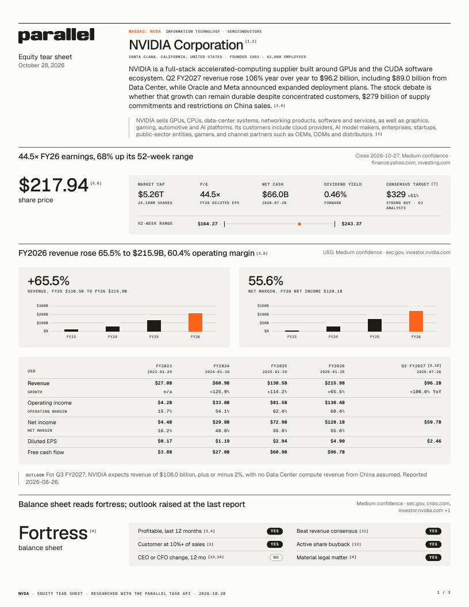
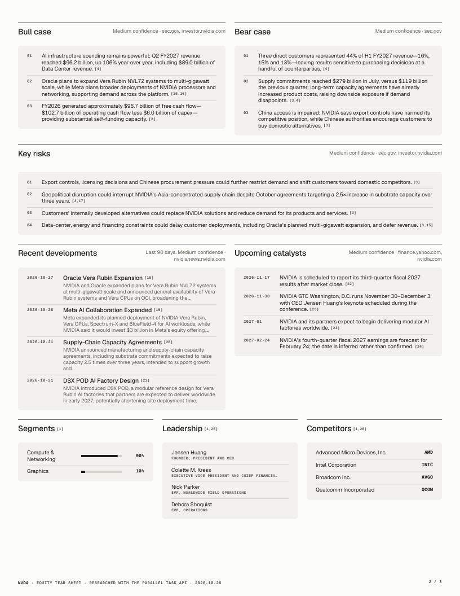
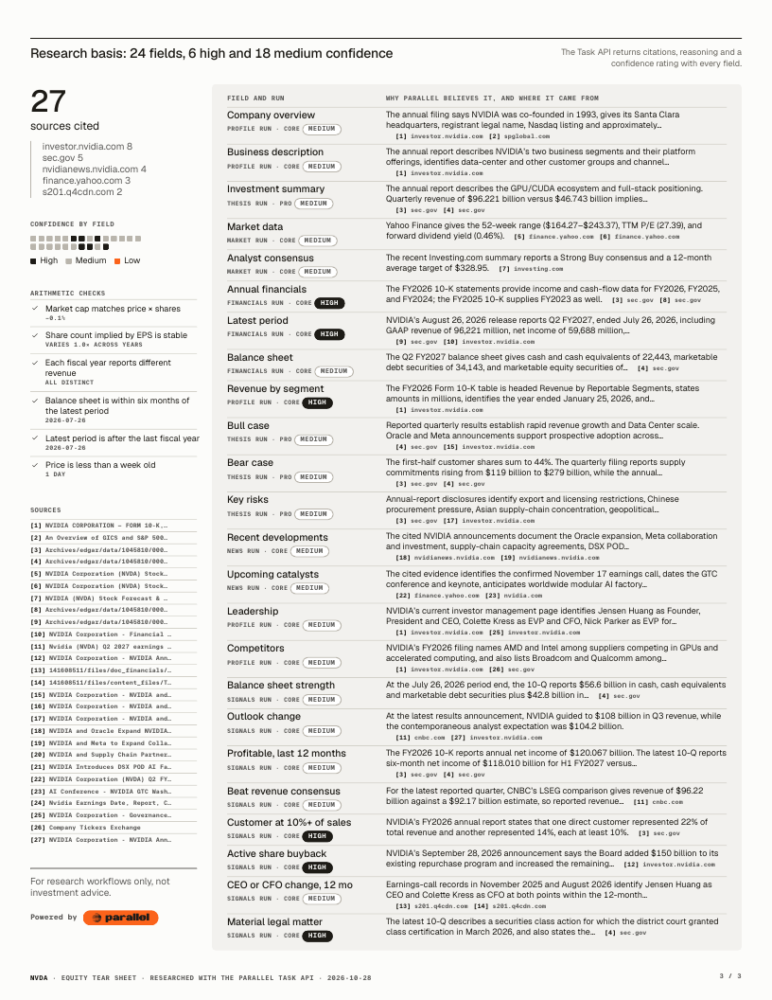

# Parallel Tear Sheets

Turn a CSV of public companies into cited, two-page equity tear sheets, one PDF per company plus a combined book. Every fact comes from the [Parallel Task API](https://docs.parallel.ai/task-api/task-quickstart) with its citations, reasoning and confidence; every derived number is plain Python. No other model is involved.

| Tear sheet, page 1 | Tear sheet, page 2 | Research basis |
| --- | --- | --- |
| [](sample/NVDA.pdf) | [](sample/NVDA.pdf) | [](sample/NVDA.pdf) |

## Sample input and output

- **Input:** [`companies.csv`](companies.csv), 23 rows of `company_name, ticker, website`.
- **Output:** [`sample/NVDA.pdf`](sample/NVDA.pdf), [`sample/MC.PA.pdf`](sample/MC.PA.pdf) (LVMH: euros, half-year reporting, no SEC filings) and [`sample/JPM.pdf`](sample/JPM.pdf) (a bank, so no operating income, net cash or free cash flow).
- **Raw research:** [`sample/NVDA.json`](sample/NVDA.json), the six Task API results behind the NVIDIA sheet, with each field's citations, reasoning and confidence. Page excerpts are removed from the sample.

## What it shows

- **Task Groups for a whole CSV.** One group holds every run, so a 100-company list is one job to watch.
- **Focused section runs instead of one big run.** Five small `core` runs per company beat one large `pro` run on completeness, for about the same price.
- **Source policies per section.** Financials are restricted to SEC filings and the company's own site; news is restricted to the last 90 days with `after_date`.
- **A two-stage pipeline.** A `pro` thesis run starts for each company as soon as its sections finish, with their facts passed in as input.
- **Research basis you can audit.** Each section names its confidence and sources, and a third page lists every field with Parallel's reasoning and citations.
- **Arithmetic checks.** The renderer cross-checks independently researched fields (market cap vs price × shares, EPS share basis across years, dates) and flags mismatches.

## Quick start

```bash
cd python-recipes/parallel-tear-sheets
cp .env.example .env            # add your PARALLEL_API_KEY
uv run tearsheet.py companies.csv --limit 3
```

`--limit 3` researches the first three rows (about $0.68) so you can check the output before running the whole file. PDFs land in `out/pdf/`, the combined book in `out/tearsheets.pdf`. Run the full CSV with the same `--out` folder and the first three companies are reused, not paid for again.

PDF rendering uses [WeasyPrint](https://weasyprint.org), which needs the Pango library: `brew install pango` on macOS (the script finds Homebrew's copy on its own), `sudo apt install libpango-1.0-0 libpangoft2-1.0-0` on Debian or Ubuntu.

Without uv: `pip install parallel-web jinja2 weasyprint python-dotenv`, then `python tearsheet.py companies.csv`.

## Your own companies

The CSV needs `company_name` and `ticker`. `website` is optional but recommended: it is what lets the financials run read the company's own annual reports, which matters for companies that don't file with the SEC. Use the exchange suffix for non-US listings (`MC.PA`, `7974.T`, `RR.L`).

```csv
company_name,ticker,website
NVIDIA,NVDA,nvidia.com
LVMH Moet Hennessy Louis Vuitton,MC.PA,lvmh.com
```

The bundled `companies.csv` covers 23 deliberately different companies: a bank, an insurer, a REIT, a utility, an airline, a pre-revenue biotech, a recent IPO, loss-making growth companies, and non-US reporters in EUR, JPY, GBP, TWD and CNY.

## How it works

```
companies.csv
   │
   ├─ Task Group ─┬─ profile     core   company, business, segments, leadership, competitors
   │              ├─ financials  core   4 fiscal years, latest period, balance sheet   (sec.gov + company site only)
   │              ├─ market      core   price, market cap, 52-week range, consensus
   │              ├─ news        core   last 90 days, upcoming catalysts               (after_date)
   │              ├─ signals     core   six yes/no checks, outlook direction, balance sheet rating
   │              └─ thesis      pro    summary, bull and bear case, risks, given the five sections' facts
   │
   └─ render.py: derived metrics, headlines, checks, charts → HTML → PDF
```

`spec.py` holds every output schema; `tearsheet.py` runs the research; `render.py` and `templates/tearsheet.html.j2` turn saved results into PDFs. `--render-only` re-renders from `out/data/` without calling the API, which is the fast loop for changing the design.

### Design decisions

**Sections, not one big run.** We tested one run with all fields on `core`, one on `pro`, and five focused sections. Sections were as complete as the single `core` run and much more complete than `pro`, which left 7 to 20 of 32 financial cells empty. Sections also get their own source policies, cite more sources, and can be refreshed on different schedules: market data daily, news weekly, financials quarterly.

**Money stays in the reporting currency.** Financials are in millions of whatever currency the statements use, with the code alongside, so Toyota reports in yen and LVMH in euros with no guessed FX rate. Market cap is always in USD for comparison. P/E is computed only when the price and EPS are in the same currency; otherwise the sheet shows the quoted trailing P/E and says so.

**Ask for facts, compute the rest.** Growth, margins, free cash flow, net cash, P/E, upside and the section headlines ("FY2026 revenue rose 65.5% to $215.9B, 60.4% operating margin") are computed from reported figures. Parallel answers what the filings say; Python does the arithmetic, so a sheet can't contradict itself.

**Field descriptions carry the definitions.** In testing, the disagreements between runs were never invented numbers. They were units (market cap in trillions instead of billions), definitions (whether long-term investments count as cash) and stock splits (EPS before and after a split). The schemas now pin each of these down, and the checks catch what slips through.

**Signals are Task fields, not a separate API.** The yes/no checks are one more `core` run, so they carry the same citations, reasoning and confidence as everything else and appear on the basis page.

**Resumable by default.** Each batch is saved in `out/state.json` before submission, with automatic submission retries disabled. If the script stops, run the same command again: it recovers the pending batch's run ids from Task Group metadata before starting anything new. If any ids are missing or ambiguous, it stops without resubmitting. Keep the state file and retry later; if the batch remains unresolved, reconcile it manually. Use only one process per output folder. Task runs can't be cancelled once created, so pilot with `--limit` first. For CSVs in the tens of thousands, see the [Large Scale Tasks recipe](../Large_Scale_Tasks_Recipe.py).

**Partial results.** Missing or failed sections are marked on the research basis page, and the command exits with a nonzero status if any company has incomplete research or could not render. Successful sections and PDFs are still saved. Citation numbers and source titles in the PDFs link to the original sources.

## Cost and time

Per company: five `core` runs and one `pro` run, about **$0.23** at [list prices](https://docs.parallel.ai/getting-started/pricing). Runs execute concurrently, so wall-clock time is set by the slowest company rather than the number of rows.

On the bundled 23 companies (October 2026): 138 runs, no failures, 9.2 minutes end to end, $5.17. Every company came back with four fiscal years in its own reporting currency, and every sheet rendered to two pages plus the basis page. The arithmetic checks flagged three sheets, each for a real reason worth a reader's attention: Celsius's oldest EPS predates its 2023 stock split, CAVA's predates its IPO, and Berkshire's two share classes break the price × shares comparison.

## Limitations

- Prices, 52-week ranges and analyst consensus come from public quote pages and are dated to the last close the run found. Confirm them before trading, or pass your own market data feed through [`mcp_servers`](https://docs.parallel.ai/task-api/mcp-tool-call).
- Confidence ratings and arithmetic checks flag doubtful fields; they do not prove the rest correct. Read the basis page.
- The Parallel brand fonts are licensed and not included. Sheets use Geist and Geist Mono from Google Fonts; set `TEARSHEET_FONT_DIR` to a folder of the brand TTFs if you have them.

## License

MIT
